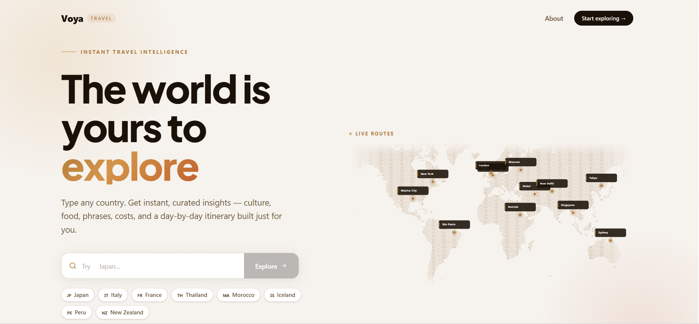

# Voya — Country Insights & Culture

> Pick a country. Explore its culture, food, landmarks, and everyday life — free, with no account needed to explore.

## About

Voya started with curiosity about places: their people, traditions, food, and what everyday life looks like there. I wanted a simple way to explore a country that caught my interest and find useful information in one place.

Voya is a free website for getting to know countries through their culture, local dishes, landmarks, holidays and festivals, useful phrases, and estimated costs. Whether you’re curious about somewhere new, learning about your roots, or considering a visit, it gives you a starting point to explore further.

You can also use Voya to gather ideas for a trip, including suggested itineraries. These are starting points, and accuracy isn’t guaranteed. Before making travel decisions, check current local news, official travel advisories, entry requirements, regulations, prices, and opening hours directly with relevant authorities and providers. Conditions can change, and Voya’s information may not reflect the latest updates.

## Features

- 🌍 Search any of 195 countries instantly
- 🗺️ Interactive map with city explorer
- 🍜 Local food guides and must-try dishes
- 💬 Essential travel phrases with pronunciation
- 💰 Estimated costs to help understand local budgets
- 🎉 Country holidays and festivals
- 📅 Suggested day-by-day itineraries to support further research
- 🛡️ General safety information to supplement current official advisories
- 🎒 Smart packing lists by destination

## Tech Stack

- React + TypeScript + Vite
- Tailwind CSS + Framer Motion
- Claude AI API
- Vercel (deployment)

## Live

[voya.travel](https://voya.travel)

## License

New original Voya code and documentation introduced after commit
[`2e33c74`](https://github.com/PremPaudel05/voya/commit/2e33c74d3c9b063d916bbae6096ac83a60f39e0b)
are **proprietary and require prior written permission from Prem Paudel to reuse**,
including for noncommercial projects. See [LICENSE](LICENSE) for the scope and exceptions.

Previously released MIT-licensed material remains available under its original
[MIT terms](LICENSES/MIT-legacy.txt). Third-party dependencies, data, and assets
retain their own licenses; calendar-data notices are preserved in
[the credits file](public/credits/date-holidays.txt).

Using the hosted Voya website is still permitted. For permission to reuse new
proprietary contributions, contact [Prem Paudel](mailto:leduopprem15@gmail.com).

© 2026 Prem Paudel.
